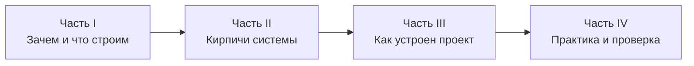
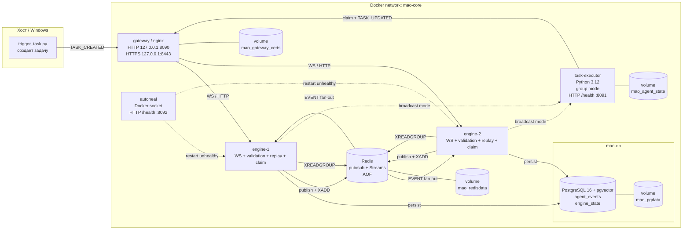
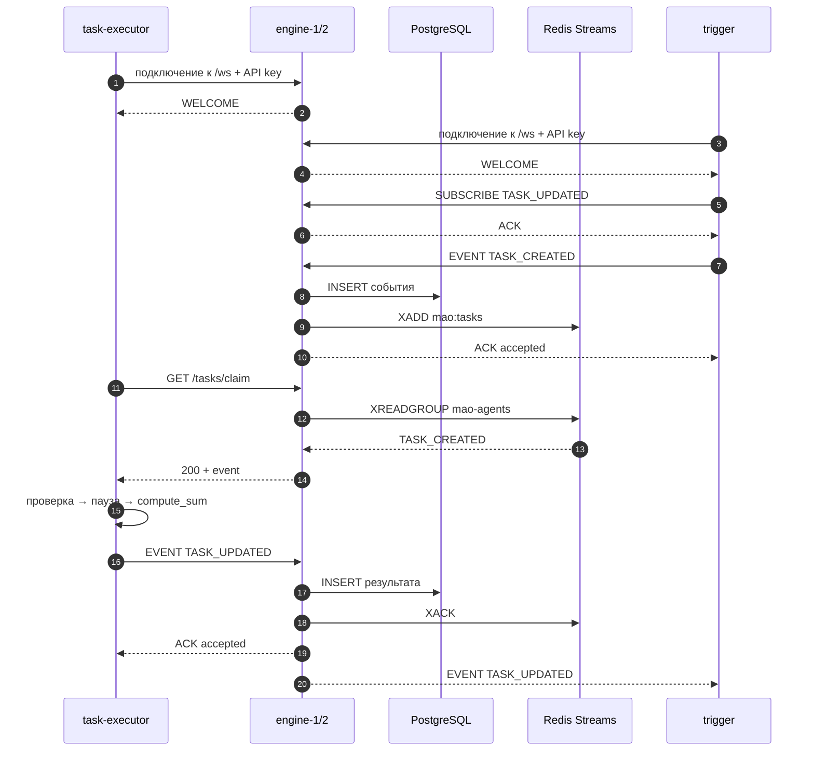

# Multi-Agent Orchestrator: учебник по проекту

> Это живой учебник. Он обновляется вместе с проектом.
> Актуально на: 2026-10-27.

Проект собран не для того, чтобы «просто работал», а чтобы на его примере
понять, как устроены распределённые системы: события, контракты, база данных,
WebSocket, контейнеры, healthcheck, идемпотентность и воспроизводимая сборка.

## Как пользоваться учебником

Учебник состоит из четырёх частей:



Читай по порядку. В каждой главе есть:

- **Цель** — что ты должен понять.
- **Объяснение** — простыми словами, с аналогиями.
- **Проверь себя** — вопросы, чтобы не обманывать себя.
- **Практика** — команды и наблюдения.

Не нужно запоминать всё. Нужно уметь объяснить один полный цикл:

> trigger создал задачу → engine проверил и сохранил → agent выполнил →
> engine сохранил результат → trigger получил ответ.

Если ты можешь объяснить эту цепочку своими словами и показать её в логах и БД,
ты уже понимаешь основу проекта.

---

# Часть I. Зачем и что мы строим

## 1. Проблема, которую решает проект

Представь, что у тебя есть несколько программ-агентов. Один умеет считать, другой
искать в документах, третий отправлять письма. Им нужно обмениваться задачами и
результатами.

Самый простой способ — один сервис напрямую вызывает другой по HTTP:

```text
trigger ──HTTP──▶ agent
```

Проблемы начинаются, когда участников становится больше:

- trigger должен знать адреса всех агентов;
- если агент недоступен, trigger должен сам решать, что делать;
- если агентов несколько, непонятно, кто должен выполнить задачу;
- ответы и ошибки нужно где-то хранить;
- при перезапуске сервиса задачи теряются.

Проект решает это через **посредника** — движок (каталог `core-engine`), который
принимает события, проверяет их, сохраняет и раздаёт подписчикам. В рабочем стеке
запущены две его одинаковые реплики: `engine-1` и `engine-2`.

**Ключевая мысль:** отправитель не знает, кто именно выполнит задачу. Он просто
публикует событие. Это называется **event-driven architecture** — архитектура,
управляемая событиями.

## 2. Что такое оркестратор

Оркестратор — это диспетчер. Он не выполняет работу сам. Он:

- принимает сообщения;
- проверяет, что они правильные;
- записывает их в журнал;
- рассылает тем, кто подписался;
- подтверждает приём.

Аналогия: **почтовое отделение с журналом**. Ты приносишь письмо, оператор
проверяет адрес, регистрирует письмо в журнале и кладёт в ящик получателю.
Отправитель не идёт к получателю домой.

В нашем проекте:

- письмо — событие;
- журнал — таблица `agent_events` в PostgreSQL;
- получатель — агент, который подписался на нужный тип события;
- подтверждение — `ACK`.

## 3. Чему ты научишься

К концу учебника ты сможешь:

1. Объяснить, чем событие отличается от команды и от HTTP-запроса.
2. Прочитать JSON Schema и понять, какие поля обязательны.
3. Понять, зачем нужны `event_id`, `correlation_id` и `request_id`.
4. Объяснить, как работает идемпотентность и почему повторная отправка не
   создаёт дубль.
5. Запустить многоконтейнерный стек через Docker Compose.
6. Отличить образ, контейнер, volume и network.
7. Понять, как работает healthcheck и reconnect.
8. Найти в логах и БД полный цикл задачи.
9. Понять, зачем нужны lock-файлы, vendoring и проверка хэшей.
10. Увидеть, чего в проекте ещё нет и почему это следующие темы.

## 4. Карта системы



### Мульти-нода простыми словами

Представь офис:

- **gateway (nginx)** — турникет на входе. Все клиенты стучатся в одну дверь
  `:8090`, а gateway распределяет их по свободным engine-репликам. Вторая дверь
  `:8443` — тот же турникет, но с TLS-шифрованием. Имена `engine-1`/`engine-2`
  резолвятся через Docker DNS каждые 10 секунд, поэтому пересоздание реплики не
  требует перезапуска gateway.
- **engine-1 / engine-2** — два одинаковых диспетчера. У них одна БД, поэтому
  события не теряются, если один из них упадёт.
- **Redis pub/sub** — радиостанция. Когда любой engine принял событие, он
  публикует его в Redis. Оба engine-реплики слушают радио и рассылают событие
  своим WebSocket-клиентам. Поэтому клиент, подключённый к engine-2, получит
  событие, которое опубликовал engine-1.
- **Redis Streams** — лента конвейера с пронумерованными коробками. Каждая
  `TASK_CREATED` попадает в stream `mao:tasks`. Агенты в group mode забирают по
  одной коробке через `/tasks/claim`; два агента делят работу, а не дублируют
  её. После результата engine делает `XACK`.
- **cursor** — личный блокнот агента в broadcast mode. Он не общий: иначе два
  агента решили бы, что задача уже обработана, и начали бы пропускать работу.
  В group mode cursor не нужен: прогресс хранит consumer group в Redis.
- **autoheal** — санитар, который перезапускает контейнер, если healthcheck
  перестал проходить. Он общается с Docker через socket, а не через Redis.
- **cert-generator** — один раз создаёт self-signed TLS-сертификат в volume
  `mao_gateway_certs`; gateway читает его при старте.

Стрелки `EVENT` на схеме идут через WebSocket/gateway; для простоты они
нарисованы от engine к агенту напрямую. Пунктир `broadcast mode` работает только
при `MAO_CONSUME_MODE=broadcast`. В режиме по умолчанию `group` агент получает
задачи через HTTP `/tasks/claim`.

Роли:

| Участник | Роль | Аналогия |
|---|---|---|
| `trigger` | Создаёт задачу и ждёт результат | Заказчик |
| `gateway` | Принимает подключения, TLS, rate limit, балансирует | Турникет |
| `engine-1/2` | Проверяют, хранят, рассылают, выдают задачи | Диспетчеры |
| `redis` | Pub/sub для fan-out и Streams для очереди задач | Радиостанция + конвейер |
| `task-executor` | Выполняет задачу | Исполнитель |
| `autoheal` | Перезапускает unhealthy-контейнеры | Санитар |
| `cert-generator` | Создаёт TLS-сертификат для gateway | Паспортный стол |
| PostgreSQL | Хранит события | Журнал |
| Docker network | Связывает контейнеры | Внутренняя локальная сеть |
| Docker volume `mao_pgdata` | Хранит данные БД | Внешний диск |
| Docker volume `mao_agent_state` | Хранит inbox/outbox/cursor агента | Блокнот исполнителя |
| Docker volume `mao_redisdata` | Хранит AOF Redis | Архив радиостанции |
| Docker volume `mao_gateway_certs` | Хранит TLS-сертификат | Сейф с паспортом |

**Проверь себя**

<details>
<summary>Почему trigger не вызывает агента напрямую?</summary>

Потому что trigger не должен знать, кто именно выполнит задачу. Он публикует
событие в engine, а engine раздаёт его подписчикам. Это уменьшает связность:
можно добавить нового агента, не меняя trigger.
</details>

---

# Часть II. Кирпичи системы

## 5. Процесс, образ и контейнер

- **Процесс** — запущенная программа в операционной системе.
- **Образ (image)** — шаблон: код + зависимости + инструкция запуска.
- **Контейнер** — запущенный экземпляр образа.

Образ — это как класс в программировании, контейнер — как объект этого класса.
Из одного образа можно запустить несколько контейнеров.

Docker нужен, чтобы:

- одинаково запускать проект на разных машинах;
- не устанавливать Python, Node.js и библиотеки на хост;
- изолировать сервисы друг от друга;
- удобно описывать сеть, порты и хранилища.

**Ключевая мысль:** на хосте не нужен Python. Всё, что нужно агенту, лежит
внутри его образа.

## 6. Сеть и порты

У каждого контейнера есть своя внутренняя сеть. В нашем проекте она называется
`mao-core`.

Внутри этой сети контейнеры видят друг друга по **именам сервисов**:

- `db` — PostgreSQL;
- `redis` — брокер событий и очередь задач;
- `engine-1`, `engine-2` — две реплики движка;
- `gateway` — nginx, который принимает клиентов, терминирует TLS и балансирует;
- `task-executor` — агент;
- `autoheal` — перезапускает unhealthy-контейнеры через Docker socket;
- `cert-generator` — одноразовый контейнер, создаёт TLS-сертификат и завершается.

Поэтому агент подключается к `ws://gateway:8090/ws`, а не к
`ws://localhost:8090/ws`. Gateway уже решает, в какую engine-реплику отправить
соединение. Каждый запрос к защищённым маршрутам несёт API-ключ:
`X-API-Key: <MAO_API_KEY>` или `Authorization: Bearer <MAO_API_KEY>`.

`localhost` внутри контейнера — это **сам контейнер**, а не хост и не соседний
контейнер. Если написать `localhost:8090` внутри агента, он будет искать gateway
внутри себя и не найдёт.

Наружу опубликованы только три порта:

- `127.0.0.1:8090` — gateway по HTTP (а за ним engine-1/engine-2);
- `127.0.0.1:8443` — gateway по HTTPS/TLS;
- `127.0.0.1:5434` — PostgreSQL.

Опционально профиль `observability` публикует `127.0.0.1:9090` для Prometheus.

Redis и сами engine-реплики наружу не опубликованы: они общаются внутри
`mao-core`. Health-порт агента `8091`, health-порт autoheal `8092` и
`/metrics` движка тоже доступны только внутри контейнера или через
`docker compose exec`. Это сделано специально: healthcheck и метрики не должны
быть публичным API.

Внутри Docker-сети трафик идёт по HTTP: сеть `mao-core` изолирована. TLS нужен на
границе, когда клиент приходит с хоста или извне. Поэтому агент использует
`ws://gateway:8090/ws`, а внешний клиент может использовать
`wss://localhost:8443/ws`.

**Проверь себя**

<details>
<summary>Почему агент в Docker не может обратиться к движку по localhost?</summary>

Потому что `localhost` внутри контейнера указывает на сам контейнер. Gateway
живёт в другом контейнере. Внутри сети Docker к нему обращаются по имени
сервиса: `gateway`.
</details>

## 7. JSON и контракты

JSON — текстовый формат данных. Он удобен тем, что его понимают почти все языки.

Пример:

```json
{
  "task_id": "task-1",
  "action": "compute_sum",
  "data": {"a": 10, "b": 20}
}
```

Но JSON сам по себе ничего не гарантирует. Можно прислать `"a": "десять"`, и
программа сломается. Поэтому нужен **контракт** — описание допустимой структуры.

В проекте контракт описан дважды:

1. **JSON Schema** — формальное описание для движка (файлы в `contracts/`).
2. **Pydantic-модели** — описание для Python-агента
   (`examples/python/event_example.py` и `agents/task_executor/protocol.py`).

Схема говорит:

- какие поля обязательны;
- какие типы у полей;
- какие значения допустимы;
- можно ли добавлять неизвестные поля.

В наших схемах неизвестные поля запрещены (`additionalProperties: false`).
Это строго: лучше явно расширить контракт, чем молча принимать мусор.

**Ключевая мысль:** контракт — это закон. Если сообщение не соответствует
схеме, движок его не сохраняет и возвращает ошибку.

## 8. HTTP и WebSocket

HTTP работает по схеме «запрос → ответ». Клиент спросил, сервер ответил, соединение
закончилось.

WebSocket — постоянное двустороннее соединение. После установки соединения сервер
может сам присылать сообщения клиенту, без нового запроса.

Нам нужен WebSocket, потому что:

- движок должен сам присылать события агенту;
- ответ может прийти позже;
- несколько событий идут по одному каналу;
- нужен heartbeat (ping/pong).

В проекте WebSocket используется для событий и управления, а HTTP — для
healthcheck и чтения состояния (`/health`, `/state`).

## 9. События и pub/sub

**Событие** — факт: «задача создана», «задача обновлена», «произошла ошибка».

**Pub/Sub** (публикация/подписка) — схема, где издатель не знает подписчиков.
Движок получает событие и рассылает его тем, кто подписался.

Подписка выглядит так:

```json
{
  "v": 1,
  "type": "SUBSCRIBE",
  "request_id": "uuid",
  "data": {"event_types": ["TASK_CREATED"]}
}
```

В нашем проекте:

- trigger подписан на `TASK_UPDATED`;
- агент в режиме по умолчанию `group` **не подписывается** на `TASK_CREATED`,
  а забирает задачи через HTTP `/tasks/claim`;
- агент в режиме `broadcast` подписывается на `TASK_CREATED` и получает события
  по WebSocket;
- engine-реплики рассылают события своим WebSocket-клиентам;
- между репликами событие передаётся через Redis pub/sub;
- каждая `TASK_CREATED` также попадает в Redis Stream `mao:tasks`.

Как это выглядит в multi-node:

1. Клиент подключён к одной engine-реплике через gateway.
2. Любая реплика приняла событие и сохранила его в БД.
3. Она публикует событие в Redis-канал `mao:events` и делает `XADD` в
   `mao:tasks`.
4. Обе реплики слушают канал и рассылают событие своим локальным подписчикам.
5. Поэтому клиент на `engine-2` получает событие, опубликованное через
   `engine-1`.
6. Агенты в group mode забирают задачи из stream через consumer group
   `mao-agents`; разные агенты получают разные задачи.

**Pub/sub и Streams — разные инструменты.**

- Pub/sub — радио: сообщение слышат все, кто сейчас слушает; offline-клиент его
  не получит.
- Streams — конвейер с журналом: запись хранится, пока её не удалят; consumer
  group помнит, кто что забрал, и позволяет вернуть зависшую задачу.

Для пропущенных задач в broadcast mode используется replay по cursor (глава 19).
В group mode cursor не нужен: прогресс хранится в Redis consumer group, а
`XACK` делается после сохранения результата.

**Важно:** общий cursor на всех агентов в broadcast mode — неправильная идея:
два агента решат, что задача уже обработана. Если нужно делить работу, используй
group mode и Redis Streams. Два агента в group mode не дублируют задачу; два
агента в broadcast mode получат один и тот же `TASK_CREATED` и оба выполнят
работу.

## 10. ACK, event_id, correlation_id

Три идентификатора легко перепутать.

- **`event_id`** — уникальный номер события. Это ключ идемпотентности.
- **`correlation_id`** — номер бизнес-операции. У запроса и ответа он одинаковый.
- **`request_id`** — номер конкретного WebSocket-запроса. По нему приходит `ACK`.

**ACK** — подтверждение: «я принял и сохранил».

Если отправить событие с уже существующим `event_id`, движок:

- не создаёт вторую запись;
- отвечает `ACK` со статусом `duplicate`;
- не рассылает событие повторно.

Это **идемпотентность**: повторная операция не меняет результат.

**`sequence_id`** — номер записи в БД. Он задаёт порядок. В нём возможны
пропуски: повторная попытка с тем же `event_id` может «съесть» номер, даже если
запись не создалась. Это нормально; важен порядок, а не непрерывность.

**Ключевая мысль:** `event_id` защищает от дублей, `correlation_id` связывает
запрос и ответ, `request_id` связывает запрос и ACK.

## 11. База данных и миграции

PostgreSQL хранит события в таблице `agent_events`.

Зачем база, если события и так летят по WebSocket?

- события нужно сохранять навсегда;
- по ним можно восстановить историю;
- можно проверить, что задача и результат связаны;
- можно строить отчёты и отладку;
- данные переживают перезапуск контейнера.

В проекте есть три основные таблицы:

| Таблица | Назначение |
|---|---|
| `agent_events` | Все события: `event_id`, тип, payload, `correlation_id` |
| `engine_state` | Служебное состояние движка, например последний boot |
| `schema_migrations` | Какие миграции уже применены |

**Миграция** — это версионированное изменение схемы БД. Движок при старте
применяет новые миграции и записывает их в `schema_migrations`. Так схему можно
менять без ручного выполнения SQL.

Volume `mao_pgdata` хранит данные БД вне контейнера. Если контейнер удалить и
создать заново, данные останутся. Volume `mao_agent_state` хранит inbox/outbox
и cursor агента. Volume `mao_redisdata` хранит AOF-журнал Redis, а
`mao_gateway_certs` — TLS-сертификат. Все они переживают перезапуск; если
выполнить `docker compose down -v`, они удалятся вместе с данными. Для второго
агента (профиль `scale`) используется отдельный `mao_agent_state_2`.

## 12. Healthcheck, heartbeat и reconnect

**Healthcheck** — периодическая проверка «сервис жив?».

- У БД healthcheck — `pg_isready`.
- У Redis — `redis-cli ping`.
- У движка — HTTP `/health`, который проверяет БД и Redis; если Redis недоступен,
  движок считается degraded.
- У gateway — HTTP `/health`, который проксируется в engine-реплику.
- У агента — HTTP `/health` на порту `8091` внутри контейнера.
- У autoheal — HTTP `/health` на порту `8092`; он проверяет, что последний опрос
  Docker socket был успешным.

Агент считается здоровым, если:

- WebSocket подключён;
- агент `ready`: подписан в broadcast mode или успешно делает claim в group mode;
- последняя активность была меньше 30 секунд назад.

Агент сам отправляет `PING` каждые 10 секунд; движок отвечает `PONG`. Это
дополнительная проверка, что канал действительно живой.

**Heartbeat** — контрольные ping/pong на уровне WebSocket. Движок отправляет
ping каждые 30 секунд; если клиент не ответил pong, соединение может быть
закрыто.

**Reconnect** — если соединение порвалось, агент ждёт (с увеличивающейся
задержкой) и подключается снова. После reconnect он заново получает `WELCOME`
и заново подписывается. Подписки не сохраняются навсегда.

Docker сам **не перезапускает** контейнер, если тот стал `unhealthy`. Он только
показывает статус. В проекте это делает сервис `autoheal`: он раз в 15 секунд
смотрит контейнеры с label `mao.autoheal=true` и перезапускает unhealthy.

## 13. Docker Compose, volume и network

`docker-compose.yml` описывает весь стек:

- `db` — PostgreSQL + pgvector;
- `redis` — pub/sub, Streams и AOF-журнал;
- `engine-1`, `engine-2` — две одинаковые реплики движка;
- `gateway` — nginx на `127.0.0.1:8090` (HTTP) и `127.0.0.1:8443` (HTTPS);
- `task-executor` — агент в group mode;
- `autoheal` — перезапуск unhealthy-контейнеров;
- `cert-generator` — одноразовый контейнер, создаёт TLS-сертификат;
- `prometheus` — только с профилем `observability`;
- `task-executor-2` — только с профилем `scale`, второй агент для проверки
  распределения задач.

Основные команды:

```powershell
docker compose up -d --build
docker compose ps
docker compose logs -f task-executor
docker compose logs -f engine-1
docker compose logs -f gateway
docker compose --profile scale up -d
docker compose --profile observability up -d
docker compose down
```

- `up` — создать и запустить.
- `-d` — в фоне.
- `--build` — сначала собрать образы.
- `--profile scale` — добавить второго агента.
- `--profile observability` — добавить Prometheus.
- `ps` — показать статус.
- `logs` — показать логи.
- `down` — остановить и удалить контейнеры и сеть, но **не volumes**.

Volumes:

- `mao_pgdata` — данные PostgreSQL;
- `mao_agent_state` — inbox/outbox/cursor первого агента;
- `mao_agent_state_2` — состояние второго агента (профиль `scale`);
- `mao_redisdata` — AOF-файлы Redis;
- `mao_gateway_certs` — self-signed TLS-сертификат;
- `mao_prometheus_data` — данные Prometheus (профиль `observability`).

`docker compose down -v` удаляет все volume, то есть стирает данные БД,
состояние агентов, журнал Redis, TLS-сертификат и метрики. Используй только если
действительно хочешь стереть всё.

## 14. Воспроизводимая сборка

В этом окружении Docker-машина не имеет выхода в интернет. Поэтому зависимости
хранятся внутри проекта:

- `core-engine/vendor/node_modules.tar.gz` — npm-зависимости;
- `core-engine/vendor/SHA256SUMS` — хэш архива;
- `agents/task_executor/vendor/wheels/` — Python-колёса для linux/amd64;
- `agents/task_executor/vendor/wheels-arm64/` — колесо `pydantic-core` для
  linux/arm64;
- `agents/task_executor/requirements.lock` — точные версии и хэши колёс для обеих
  архитектур.

Dockerfile проверяет хэши перед установкой:

- движок: `sha256sum -c SHA256SUMS`;
- агент: `pip install --require-hashes -r requirements.lock`.

При сборке arm64 pip выбирает arm64-колесо из общего каталога, при amd64 —
x86_64-колесо. Поэтому multi-arch сборка не требует сети на этапе установки
Python-зависимостей.

Зачем:

- сборка не зависит от того, что сейчас лежит в интернете;
- версии фиксированы;
- подмену файла можно заметить по хэшу;
- результат воспроизводим на amd64 и arm64.

Базовые образы `node:20-alpine` и `python:3.12-slim` в этом окружении были
загружены заранее. На машине с интернетом Docker скачает их сам.

## 15. Безопасность: что уже есть и чего нет

Что уже есть:

- API-ключ `MAO_API_KEY` для HTTP и WebSocket;
- заголовок `X-API-Key` или `Authorization: Bearer`;
- TLS 1.2/1.3 на gateway (`:8443`), self-signed сертификат для локальной
  разработки;
- rate limiting и limit_conn на gateway по IP;
- `/health` и `/metrics` не требуют ключа, но доступны только внутри сети;
- Redis и engine-реплики не опубликованы наружу;
- секреты (пароль БД и API-ключ) лежат в `.env`, исключённом из git и
  Docker-контекста.

Чего ещё нет:

- пользователей, ролей и tenant isolation;
- доверенного сертификата (сейчас self-signed);
- квот по `sender_id` или API-ключу;
- secret manager вместо `.env`;
- проверки, что `sender_id` действительно принадлежит отправителю.

`autoheal` монтирует Docker socket. Это очень мощный интерфейс: не публикуй
autoheal наружу и не давай к нему доступ недоверенным процессам.

Перед публикацией в интернет нужен доверенный сертификат, per-user
аутентификация, квоты и secret manager.

**Проверь себя**

<details>
<summary>Почему event_id и correlation_id — это не одно и то же?</summary>

`event_id` идентифицирует конкретное событие и защищает от дублей.
`correlation_id` идентифицирует бизнес-операцию и связывает несколько разных
событий (например, `TASK_CREATED` и `TASK_UPDATED`).
</details>

<details>
<summary>Почему подписки исчезают после reconnect?</summary>

Подписки хранятся в памяти соединения на стороне движка. При разрыве соединения
они теряются. После reconnect агент обязан подписаться заново.
</details>

---

# Часть III. Как устроен наш проект

## 16. Один цикл задачи



По шагам:

1. Агент подключается к WebSocket с API-ключом и получает `WELCOME`.
2. Trigger подключается и подписывается на `TASK_UPDATED`.
3. Trigger отправляет `TASK_CREATED`.
4. Engine валидирует событие.
5. Engine сохраняет событие в БД.
6. Engine добавляет задачу в Redis Stream `mao:tasks`.
7. Engine отправляет `ACK` отправителю.
8. Агент в group mode забирает задачу через `GET /tasks/claim`.
9. Агент проверяет payload, выполняет действие и формирует `TASK_UPDATED`.
10. Агент отправляет результат с тем же `correlation_id`.
11. Engine сохраняет результат, делает `XACK` и рассылает событие trigger.

В broadcast mode шаги 6 и 8 заменяются подпиской на `TASK_CREATED` и обычной
рассылкой через WebSocket.

`WELCOME` отправляет **движок**, а не агент. Это частая путаница.

## 17. Протокол v1.3

Сообщение состоит из **конверта** и **данных**.

Конверт клиента:

```json
{
  "v": 1,
  "type": "EVENT",
  "request_id": "uuid",
  "data": {}
}
```

Серверный `EVENT` дополнительно содержит `sequence_id`:

```json
{
  "v": 1,
  "type": "EVENT",
  "sequence_id": 42,
  "data": {}
}
```

`sequence_id` — это метаданные сервера, а не часть события. По ним агент двигает
consumer cursor для replay.

Типы сообщений:

| Тип | Кто отправляет | Зачем |
|---|---|---|
| `WELCOME` | Engine | Приветствие и параметры соединения |
| `SUBSCRIBE` | Client | Подписаться на типы событий |
| `UNSUBSCRIBE` | Client | Отписаться |
| `EVENT` | Оба | Событие |
| `ACK` | Engine | Подтверждение |
| `PONG` | Engine | Ответ на PING |
| `ERROR` | Engine | Ошибка протокола |

Типы событий:

- `TASK_CREATED`
- `TASK_UPDATED`
- `AGENT_MESSAGE`
- `SYSTEM_COMMAND`
- `ERROR`

Сейчас реально используются первые два.

Событие `TASK_CREATED` содержит:

- `task_id`, `title`, `created_by` — обязательные поля v1;
- `action`, `data` — добавлены в v1.1 для выполнения задач;
- `priority`, `deadline` — необязательные.

В v1.2 добавлены `sequence_id` в серверный `EVENT` и replay HTTP API. Wire-версия
остаётся `v = 1`.

В v1.3 добавлены API-key-аутентификация, TLS на gateway, Redis Streams claim API
и `/metrics`. Формат конверта и события не изменился, поэтому wire-версия
по-прежнему `v = 1`.

Агент требует `action` и `data`, потому что без них не знает, что делать.

Полное описание: `protocol-spec.md` и `contracts/*.json`.

## 18. core-engine: что внутри

Основные файлы:

| Файл | Роль |
|---|---|
| `src/server.js` | HTTP и WebSocket, обработка сообщений |
| `src/protocol.js` | Загрузка схем и валидация через Ajv |
| `src/persistence.js` | Идемпотентная запись события |
| `src/migrations.js` | Применение SQL-миграций |
| `src/db.js` | Пул подключений к PostgreSQL |
| `src/redis.js` | Pub/sub мост между engine-репликами |
| `src/taskStream.js` | Redis Streams: `XADD`, `XREADGROUP`, `XACK`, `XAUTOCLAIM` |
| `src/auth.js` | Проверка API-ключа для HTTP и WebSocket |
| `src/metrics.js` | Счётчики, gauges и гистограммы Prometheus |
| `src/config.js` | Переменные окружения |

Порядок старта:

1. Ждём, пока БД станет доступна.
2. Применяем миграции.
3. Записываем boot-маркер в `engine_state`.
4. Подключаемся к Redis и подписываемся на канал `mao:events`.
5. Создаём consumer group `mao-agents` для stream `mao:tasks`.
6. Запускаем HTTP/WS-сервер.

При получении `EVENT`:

1. Проверяем конверт и событие по JSON Schema.
2. Вставляем событие в `agent_events` с `ON CONFLICT (event_id) DO NOTHING`.
3. Для `TASK_CREATED` делаем `XADD` в `mao:tasks`; операция идемпотентна по
   `correlation_id`.
4. Отправляем `ACK`; новое событие публикуем в Redis, duplicate не публикуем.
5. Для `TASK_UPDATED` делаем `XACK` записи stream по `correlation_id`.

Именно здесь живёт идемпотентность.

`/health` проверяет и БД, и Redis. Если Redis недоступен, engine считается
degraded: без него не работает межрепликационная рассылка и выдача задач.

Две engine-реплики запускают миграции одновременно, но advisory lock в
PostgreSQL не даёт применить одну миграцию дважды.

Для replay движок дополнительно отдаёт read-only HTTP API:

- `GET /events/cursor?event_type=TASK_CREATED` — текущий максимум
  `sequence_id`;
- `GET /events?event_type=TASK_CREATED&after_sequence_id=N&limit=100` —
  пропущенные события по возрастанию `sequence_id`.

Серверный `EVENT` содержит `sequence_id`, чтобы агент в broadcast mode мог
двигать свой cursor.

Для group mode движок отдаёт:

- `GET /tasks/claim?agent_id=...&block_ms=5000&idle_ms=60000` — взять одну
  задачу из consumer group; `200` с событием или `204`, если задач нет;
- `GET /metrics` — метрики Prometheus (только внутри сети).

Все защищённые маршруты проверяют `X-API-Key` или `Authorization: Bearer`.
`/health` и `/metrics` ключа не требуют.

## 19. task-executor: что внутри

Основные файлы:

| Файл | Роль |
|---|---|
| `agent.py` | Подключение, reconnect, worker, health, выполнение |
| `protocol.py` | Pydantic-модели серверных сообщений |
| `trigger_task.py` | Тестовый клиент-заказчик |
| `state.py` | SQLite inbox/outbox и consumer cursor |
| `tests/` | Unit-тесты |
| `vendor/wheels/` | Python-зависимости для amd64 |
| `vendor/wheels-arm64/` | `pydantic-core` для arm64 |
| `requirements.lock` | Версии и хэши колёс |

Жизненный цикл агента в group mode (по умолчанию):

1. Подключиться к `/ws` через gateway с API-ключом.
2. Получить `WELCOME`.
3. Восстановить незавершённые задачи из inbox (SQLite).
4. Запустить claim loop: `GET /tasks/claim` с `agent_id`.
5. Получить задачу, сохранить её в inbox **до** обработки.
6. Проверить payload и выполнить действие (`compute_sum` или `echo`).
7. Создать `TASK_UPDATED` с тем же `correlation_id` и детерминированным
   `event_id`.
8. Положить результат в outbox и пометить задачу выполненной.
9. Отправить outbox; при ошибке — повторить с тем же `event_id`.
10. Engine сохранит результат и сделает `XACK`; агент сразу забирает следующую
    задачу.
11. При разрыве — переподключиться и продолжить claim/inbox/outbox.

В broadcast mode шаги 3–5 заменяются на подписку `TASK_CREATED`, cursor и replay
через `/events`.

Особенности:

- один worker — задачи выполняются последовательно;
- inbox/outbox хранятся в SQLite на volume `mao_agent_state`;
- дедупликация задач — по `event_id` в inbox;
- результат имеет детерминированный `event_id` (UUIDv5 от задачи и agent_id),
  поэтому повторная отправка безопасна;
- health-сервер работает в отдельном потоке;
- app-level `PING` каждые 10 секунд обновляет `last_pong_at`;
- health считается `ok`, когда соединение установлено, агент `ready` и
  активность не старше 30 секунд;
- `compute_sum` требует числа `a` и `b`, иначе возвращает `FAILED`.

### Durable delivery

Что происходит, если агент упадёт между получением задачи и отправкой результата?

- `TASK_CREATED` уже записан в **inbox** → после рестарта агент найдёт задачу
  со статусом `pending/processing`, сбросит её в `pending` и выполнит заново.
- Результат перед отправкой записывается в **outbox** → если ACK не пришёл,
  агент повторит отправку с тем же `event_id`. Движок ответит `accepted` или
  `duplicate`; второй записи в БД не будет.

Посмотреть состояние:

```powershell
docker compose exec -T task-executor python -c "import sqlite3; c=sqlite3.connect('/app/state/agent.db'); print('inbox', c.execute('select event_id,status from inbox').fetchall()); print('outbox', c.execute('select event_id,status,attempts from outbox').fetchall())"
```

Статусы:

- inbox: `pending`, `processing`, `done`, `failed`;
- outbox: `pending`, `sent`, `failed`.

#### Replay пропущенных задач (broadcast mode)

Этот механизм нужен только в `MAO_CONSUME_MODE=broadcast`. В group mode прогресс
хранит Redis Streams, и отдельный cursor не используется.

Inbox/outbox закрывают рестарт агента, но не случай «агент был offline, когда
движок рассылал `TASK_CREATED`». Для этого добавлен consumer cursor.

Как это работает:

1. В серверном `EVENT` теперь есть `sequence_id` — номер записи в БД.
2. Агент хранит в SQLite ключ `last_sequence_id` — последний обработанный
   `TASK_CREATED`.
3. После обработки задачи cursor сдвигается вперёд.
4. При первом запуске агент спрашивает у движка текущий максимум и начинает
   с него; старую историю он не переигрывает.
5. После подписки агент запрашивает пропущенные события:

```http
GET /events?event_type=TASK_CREATED&after_sequence_id=63&limit=100
```

6. Найденные события кладутся в inbox; дубликаты отбрасываются по `event_id`.

Проверить cursor:

```powershell
docker compose exec -T task-executor python -c "import sqlite3; c=sqlite3.connect('/app/state/agent.db'); print(c.execute('select value from state where key=?',('last_sequence_id',)).fetchone())"
```

Cursor движка:

```powershell
$key = (Select-String .env -Pattern '^MAO_API_KEY=').Line.Split('=', 2)[1]
Invoke-RestMethod -Headers @{ 'X-API-Key' = $key } "http://localhost:8090/events/cursor?event_type=TASK_CREATED"
```

Если остановить агента, создать задачу и снова запустить агента, в его логах
появится `replay completed replayed=1`, а задача выполнится. Это и есть
at-least-once доставка задач для случая offline-агента.

<details>
<summary>Почему новый агент не переигрывает всю историю?</summary>

При первом запуске у него ещё нет cursor. Он спрашивает `/events/cursor`,
получает текущий максимум и начинает с него. Всё, что было раньше, считается
историей, а не пропущенными задачами. Если нужен полный replay с нуля, это
отдельный административный сценарий, а не поведение нового consumer по
умолчанию.
</details>

#### Group mode: claim из Redis Streams

В group mode задача не приходит по WebSocket. Агент сам спрашивает движок:

```http
GET /tasks/claim?agent_id=task-executor-agent&block_ms=5000&idle_ms=60000
X-API-Key: <MAO_API_KEY>
```

- `200` — задача есть, в ответе `stream_id` и `event`;
- `204` — задач сейчас нет, можно спросить снова;
- `503` — Redis/stream недоступны, нужен backoff.

Как это устроено:

1. Каждая `TASK_CREATED` делает `XADD mao:tasks`.
2. Consumer group `mao-agents` хранит, кто какую запись забрал.
3. Агент с уникальным `agent_id` делает `XREADGROUP` через движок.
4. Два агента с разными `agent_id` получают разные задачи.
5. После `TASK_UPDATED` движок делает `XACK`.
6. Если агент упал, запись остаётся pending; тот же `agent_id` прочитает её при
   рестарте, а другой агент сможет забрать её через `XAUTOCLAIM` после
   `idle_ms`.

Доставка **at-least-once**: задача может выполниться повторно, но результат
идемпотентен по `event_id`, поэтому второй записи в БД не будет.

Проверить группу:

```powershell
docker compose exec -T redis redis-cli XINFO GROUPS mao:tasks
docker compose exec -T redis redis-cli XPENDING mao:tasks mao-agents
```

Запустить второго агента:

```powershell
docker compose --profile scale up -d
```

Теперь две задачи могут выполняться параллельно разными агентами. В поле
`worker` результата будет `task-executor-agent` или `task-executor-agent-2`.

#### Почему cursor у каждого агента свой?

Это объяснение относится к broadcast mode. Cursor — личный блокнот: «до какого
номера я уже обработал». Если положить один общий cursor в Redis и дать его двум
агентам, произойдёт плохая вещь:

1. Агент A обработал задачу №10 и сдвинул общий cursor на 10.
2. Агент B видит cursor 10 и решает, что задачи 1–10 уже обработаны.
3. Часть задач, которую взял A, могла быть ещё не завершена — B её не возьмёт.

Поэтому в broadcast mode cursor у каждого агента свой. Redis pub/sub используется
только для передачи событий между engine-репликами; он не распределяет работу
между агентами.

Для **общего потока задач** используется group mode: Redis Streams consumer
groups (`XADD`, `XREADGROUP`, `XACK`, `XAUTOCLAIM`). Именно этот режим включён по
умолчанию.

## 20. trigger: как создаётся задача

`trigger_task.py`:

1. Подключается к `/ws` и передаёт `X-API-Key`.
2. Получает `WELCOME`.
3. Подписывается на `TASK_UPDATED` **до** отправки задачи.
4. Создаёт `TASK_CREATED` с `action="compute_sum"` и `data={"a":10,"b":20}`.
5. Ждёт `ACK` и результат.
6. Проверяет, что статус `COMPLETED` и сумма равна 30.

Подписка до отправки важна: иначе результат может прийти раньше, чем trigger
успеет подписаться.

Если ключ неверный, WebSocket upgrade завершится HTTP `401`, и trigger завершится
с ошибкой `server rejected WebSocket connection: HTTP 401`.

## 21. База данных: как посмотреть

```powershell
docker compose exec -T db psql -U orchestrator -d orchestrator -c "SELECT sequence_id, event_type, sender_id, correlation_id FROM agent_events ORDER BY sequence_id DESC LIMIT 6;"
```

Ожидаемая картина после trigger:

```text
49 | TASK_CREATED | trigger-script      | <correlation_id>
50 | TASK_UPDATED | task-executor-agent | <correlation_id>
```

Одинаковый `correlation_id` — главный признак успешного цикла.

Полезные запросы:

```sql
SELECT * FROM schema_migrations ORDER BY version;
SELECT key, value, updated_at FROM engine_state;
SELECT count(*) FROM agent_events;
```

## 22. Сборка и запуск

```powershell
docker compose up -d --build
docker compose ps
```

Что происходит:

1. Compose собирает образы engine (для двух реплик) и agent.
2. Создаёт network `mao-core`.
3. Создаёт volumes `mao_pgdata`, `mao_agent_state`, `mao_redisdata`,
   `mao_gateway_certs`.
4. Запускает PostgreSQL и Redis и ждёт их healthcheck.
5. `cert-generator` создаёт self-signed TLS-сертификат и завершается с кодом 0.
6. Запускает `engine-1` и `engine-2`; они применяют миграции, подключаются к
   Redis, создают consumer group и открывают внутренний порт 8090.
7. Запускает `gateway`; nginx начинает принимать HTTP на `:8090` и HTTPS на
   `:8443`.
8. Запускает агента; он подключается к `ws://gateway:8090/ws` с API-ключом.
9. Запускает `autoheal`.
10. Семь долгоживущих контейнеров становятся healthy; `cert-generator` — exited 0.

Проверка:

```powershell
docker compose ps
Invoke-RestMethod http://localhost:8090/health
curl.exe -k https://localhost:8443/health
docker compose exec -T task-executor python healthcheck.py
```

`/health` не требует ключа. Для защищённых запросов:

```powershell
$key = (Select-String .env -Pattern '^MAO_API_KEY=').Line.Split('=', 2)[1]
Invoke-RestMethod -Headers @{ 'X-API-Key' = $key } "http://localhost:8090/events/cursor?event_type=TASK_CREATED"
```

## 23. Тесты и автопроверка

Unit-тесты агента:

```powershell
docker compose exec -T task-executor sh -c "python -m unittest discover -s tests -v 2>&1"
```

Покрыто:

- `compute_sum`, `echo`, ошибки данных;
- health lifecycle и флаг `ready`;
- парсинг `WELCOME` и `TASK_CREATED`;
- отказ при отсутствии `correlation_id`;
- отказ при неизвестном типе события;
- дедупликация по `event_id`;
- cursor/outbox тесты.

Полная проверка:

```powershell
.\scripts\verify_stack.ps1
```

Для Linux/CI:

```sh
sh scripts/verify_stack.sh
```

Скрипт:

1. собирает и запускает стек;
2. ждёт healthy для семи долгоживущих контейнеров;
3. проверяет, что `cert-generator` завершился с кодом 0;
4. проверяет `401` без API-ключа и успешный запрос с ключом;
5. проверяет HTTPS `/health`;
6. проверяет `/metrics` и наличие метрик;
7. проверяет health агента;
8. запускает unit-тесты;
9. запускает E2E trigger;
10. проверяет consumer group `mao-agents` и отсутствие pending-задач;
11. печатает `STACK_VERIFICATION_OK`.

**Проверь себя**

<details>
<summary>Кто отправляет WELCOME?</summary>

Движок. Агент его получает, проверяет и только потом подписывается или начинает
claim loop.
</details>

<details>
<summary>В каком порядке engine обрабатывает EVENT?</summary>

Валидация → запись в БД → `XADD` для `TASK_CREATED` → ACK → публикация в Redis.
Дубликат: валидация → `ON CONFLICT` → ACK duplicate → без повторной публикации.
</details>

---

# Часть IV. Практика

## 24. Лабораторная 1. Запуск и health

```powershell
docker compose up -d --build
docker compose ps
```

Ожидаемо:

```text
mao-db             Up (healthy)
mao-redis          Up (healthy)
mao-engine-1       Up (healthy)
mao-engine-2       Up (healthy)
mao-gateway        Up (healthy)
mao-task-executor  Up (healthy)
mao-autoheal       Up (healthy)
mao-cert-generator Exited (0)
```

Проверь health:

```powershell
Invoke-RestMethod http://localhost:8090/health
curl.exe -k https://localhost:8443/health
docker compose exec -T task-executor python healthcheck.py
```

Проверь auth и метрики:

```powershell
$key = (Select-String .env -Pattern '^MAO_API_KEY=').Line.Split('=', 2)[1]
Invoke-RestMethod -Headers @{ 'X-API-Key' = $key } "http://localhost:8090/events/cursor?event_type=TASK_CREATED"
docker compose exec -T engine-1 wget -qO- http://127.0.0.1:8090/metrics
```

## 25. Лабораторная 2. Проследи один заказ

Запусти trigger:

```powershell
docker compose exec -T task-executor python -u trigger_task.py
```

Найди в выводе `correlation_id`. Затем посмотри логи:

```powershell
docker compose logs --tail=30 task-executor
```

И БД:

```powershell
docker compose exec -T db psql -U orchestrator -d orchestrator -c "SELECT sequence_id, event_type, sender_id, correlation_id FROM agent_events ORDER BY sequence_id DESC LIMIT 4;"
```

Найди две записи с одинаковым `correlation_id`. Это и есть полный цикл.

## 26. Лабораторная 3. Останови движки

Сначала попробуй остановить только одну реплику:

```powershell
docker compose stop engine-1
docker compose exec -T task-executor python healthcheck.py
```

Скорее всего, агент останется здоровым: gateway отправит новые подключения на
`engine-2`, а уже открытое соединение может быть на любой реплике. Это и есть
смысл двух engine.

Теперь останови обе реплики:

```powershell
docker compose stop engine-1 engine-2
docker compose exec -T task-executor python healthcheck.py
```

Health должен вернуть `503` и exit 1. Затем:

```powershell
docker compose start engine-1 engine-2
Start-Sleep -Seconds 10
docker compose exec -T task-executor python healthcheck.py
```

Агент должен переподключиться через gateway и снова стать здоровым. В логах ищи:

```text
session closed
reconnect scheduled
welcome received
agent ready
task claim loop started
```

В логах engine-1/engine-2 должны быть строки `redis bridge ready` и
`core engine listening`.

### Проверка durable delivery

После успешной задачи посмотри состояние inbox/outbox:

```powershell
docker compose exec -T task-executor python -c "import sqlite3; c=sqlite3.connect('/app/state/agent.db'); print('inbox', c.execute('select event_id,status from inbox').fetchall()); print('outbox', c.execute('select event_id,status,attempts from outbox').fetchall())"
```

Ожидаемо: задача в inbox со статусом `done`, результат в outbox со статусом
`sent`. Это значит, что задача и результат уже сохранены на volume
`mao_agent_state`, а не только в памяти.

Если увеличить `TASK_EXECUTION_DELAY_SECONDS` и перезапустить агента во время
выполнения задачи, в логах появится `inbox resumed count=1`, задача выполнится
заново, а результат всё равно будет ровно один: `event_id` результата
детерминированный, движок отбросит дубль.

## 27. Лабораторная 4. Тесты и полная проверка

```powershell
docker compose exec -T task-executor sh -c "python -m unittest discover -s tests -v 2>&1"
.\scripts\verify_stack.ps1
```

Ожидаемо: `Ran 13 tests ... OK` и `STACK_VERIFICATION_OK`.

## 28. Лабораторная 5. Измени задержку

Добавь в локальный `.env`:

```text
TASK_EXECUTION_DELAY_SECONDS=5
```

Перезапусти агента:

```powershell
docker compose up -d task-executor
```

Запусти trigger и убедись, что результат приходит примерно через 5 секунд.

Верни значение обратно, когда закончишь.

## 29. Лабораторная 6. Добавь действие

В `agents/task_executor/agent.py` в `_run_action` добавь:

```python
if action == "multiply":
    a = data.get("a")
    b = data.get("b")
    if not _is_number(a) or not _is_number(b):
        raise TaskInputError("invalid_data", "multiply requires numeric 'a' and 'b'")
    return {"product": a * b}
```

Добавь unit-тест в `tests/test_agent.py`:

```python
def test_multiply(self) -> None:
    result = self.executor._run_action("multiply", {"a": 6, "b": 7})
    self.assertEqual(result, {"product": 42})
```

Пересобери агента и запусти тесты:

```powershell
docker compose up -d --build task-executor
docker compose exec -T task-executor sh -c "python -m unittest discover -s tests -v 2>&1"
```

Чтобы проверить E2E, измени `action` и `data` в `trigger_task.py` и ожидаемый
результат в его проверке. Это упражнение на понимание того, где заканчивается
инфраструктура и начинается логика.

## 30. Troubleshooting

### Контейнер не healthy

```powershell
docker compose ps
docker compose logs --tail=100 <service>
```

- `mao-db`: проверь `.env`, порт 5434, логи PostgreSQL.
- `mao-redis`: проверь `docker compose logs redis`, `redis-cli ping` внутри
  контейнера, volume `mao_redisdata`.
- `mao-engine-1/2`: проверь БД, Redis, миграции, `contracts/`, `redis bridge ready`,
  `task stream ready`.
- `mao-gateway`: проверь, что обе engine-реплики healthy, сертификат создан и
  nginx-конфиг смонтирован.
- `mao-task-executor`: проверь `ws://gateway:8090/ws`, API-ключ, `/tasks/claim`,
  health 8091, логи.
- `mao-autoheal`: проверь Docker socket `/var/run/docker.sock` и health 8092.
- `mao-cert-generator`: это одноразовый контейнер; он должен быть `Exited (0)`.

### TLS-сертификат

Если gateway не стартует и пишет `cannot load certificate`:

```powershell
docker compose logs cert-generator
docker compose run --rm cert-generator
docker compose up -d gateway
```

Сертификат лежит в volume `mao_gateway_certs`. `docker compose down -v` удаляет
его; при следующем старте cert-generator создаст новый.

### HTTP 401 / WebSocket 401

- проверь `MAO_API_KEY` в `.env` и в окружении клиента;
- отправь `X-API-Key` или `Authorization: Bearer`;
- для браузера можно использовать `?api_key=...`, но помни про логи.

### Trigger зависает

- engine healthy?
- agent healthy?
- в group mode агент делает `GET /tasks/claim`; проверь
  `docker compose logs task-executor` на `task claimed`;
- проверь consumer group:
  `docker compose exec -T redis redis-cli XINFO GROUPS mao:tasks`;
- если в `XPENDING` висят задачи, проверь, жив ли агент и не истёк ли `idle_ms`;
- trigger подписан на `TASK_UPDATED` до отправки?

### `connection failed: Temporary failure in name resolution`

Это нормально, если gateway или engine-реплики остановлены: DNS-имя `gateway` или
`engine-1/2` временно не разрешается. После старта контейнеров агент
переподключится.

### Ошибка сборки pip/npm

- проверь vendor-файлы;
- проверь `SHA256SUMS` и `requirements.lock`;
- на чистой машине с интернетом можно использовать штатный Dockerfile engine
  и `pip`/`npm` из сети;
- для arm64 проверь `vendor/wheels-arm64` и хэш в `requirements.lock`.

### Данные пропали

Скорее всего, был выполнен `docker compose down -v`. Он удаляет volumes
`mao_pgdata`, `mao_agent_state`, `mao_agent_state_2`, `mao_redisdata`,
`mao_gateway_certs` и `mao_prometheus_data`. Без `-v` данные сохраняются.

## 31. Словарь

- **Event** — запись о произошедшем.
- **Envelope** — конверт WebSocket-сообщения.
- **WebSocket** — постоянное двустороннее соединение.
- **Pub/Sub** — публикация/подписка.
- **Subscriber** — подписчик.
- **ACK** — подтверждение приёма.
- **Idempotency** — повторная операция не создаёт дубль.
- **`event_id`** — уникальный id события.
- **`correlation_id`** — id бизнес-операции.
- **`request_id`** — id WebSocket-запроса.
- **`sequence_id`** — порядок записи в БД.
- **JSON Schema** — описание допустимого JSON.
- **Ajv** — валидатор JSON Schema в Node.js.
- **Pydantic** — валидатор моделей в Python.
- **Migration** — изменение схемы БД.
- **Volume** — постоянное хранилище Docker.
- **Network** — внутренняя сеть Docker.
- **Image** — шаблон контейнера.
- **Container** — запущенный экземпляр образа.
- **Healthcheck** — проверка «сервис жив?».
- **Heartbeat** — контрольные ping/pong.
- **Reconnect** — повторное подключение.
- **Vendoring** — хранение зависимостей в проекте.
- **Lockfile** — точные версии зависимостей.
- **Hash** — контрольная сумма файла.
- **Docker Compose** — описание многоконтейнерного стека.
- **Trigger** — тестовый клиент-заказчик.
- **API key** — общий секрет для доступа к HTTP/WebSocket.
- **TLS** — шифрование транспорта; в проекте терминируется на gateway.
- **Rate limiting** — ограничение частоты запросов с одного IP.
- **Redis Stream** — журнал задач с ID записей.
- **Consumer group** — группа потребителей, делящих stream между собой.
- **`XADD`** — добавить запись в stream.
- **`XREADGROUP`** — взять запись из stream от имени consumer.
- **`XACK`** — подтвердить обработку записи.
- **`XAUTOCLAIM`** — забрать зависшую запись у другого consumer.
- **At-least-once** — доставка минимум один раз; дубли возможны.
- **Autoheal** — перезапуск unhealthy-контейнера.
- **Metrics** — числовые показатели работы сервиса.
- **Prometheus** — система сбора метрик.
- **Self-signed certificate** — сертификат, подписанный сам собой (для dev).

## 32. Observability: метрики и алерты

Движок отдаёт `/metrics` в формате Prometheus. Маршрут не требует API-ключа и
доступен только внутри Docker-сети; снаружи его нет.

Посмотреть вручную:

```powershell
docker compose exec -T engine-1 wget -qO- http://127.0.0.1:8090/metrics
```

Основные метрики:

- `mao_events_total{event_type,result}` — принятые/дублированные события;
- `mao_events_rejected_total{reason}` — отклонённые события;
- `mao_ws_connections` — открытые WebSocket-соединения;
- `mao_ws_messages_total{type}` — сообщения по типам;
- `mao_redis_publish_total{result}` — публикация в Redis;
- `mao_task_claims_total{result}` — выдача задач (`claimed`/`empty`/`error`);
- `mao_task_acks_total{result}` — подтверждение задач;
- `mao_task_stream_length` — длина stream;
- `mao_http_requests_total{method,route,status}` — HTTP-запросы;
- `mao_http_request_duration_seconds` — гистограмма latency;
- `mao_process_uptime_seconds` и `mao_process_resident_memory_bytes`.

Prometheus запускается профилем:

```powershell
docker compose --profile observability up -d
```

Он читает `observability/prometheus.yml`, скрапит `engine-1:8090` и
`engine-2:8090`, а правила из `observability/alerts.yml` показывают алерты в
UI `http://localhost:9090`:

- `MaoEngineDown` — engine недоступен больше минуты;
- `MaoTaskBacklog` — stream длиннее 1000 записей;
- `MaoHighRejectionRate` — больше одного отклонения в секунду;
- `MaoHighDuplicateRate` — много дублей.

Alertmanager и внешние каналы уведомлений пока не подключены: алерты видны в
Prometheus, но никуда не отправляются. Трассировка пока держится на
`correlation_id` в JSON-логах; OpenTelemetry не добавлен.

## 33. CI на чистой машине

Файл `.github/workflows/ci.yml` описывает четыре job:

1. **Agent unit tests** — чистый Python 3.12, зависимости ставятся offline из
   `agents/task_executor/vendor/wheels` с `--require-hashes`, затем запускаются
   13 unit-тестов.
2. **Compose and script checks** — проверка синтаксиса `scripts/verify_stack.sh`,
   `scripts/autoheal.js` и `core-engine/src/*.js`, `docker compose config`,
   `promtool check config`, а также проверка, что выбран штатный
   `core-engine/Dockerfile`, а не локальный `Dockerfile.offline`.
3. **Multi-arch images** — через QEMU/Buildx собираются arm64-образы engine и
   agent; это проверяет arm64-колесо и multi-arch Dockerfile.
4. **Stack E2E** — создаёт `.env` из `.env.example` со случайными паролем БД и
   API-ключом, поднимает стек через `scripts/verify_stack.sh`, ждёт healthcheck,
   проверяет auth/TLS/metrics/stream, запускает unit-тесты и E2E trigger. При
   падении печатает статус контейнеров и логи, затем всегда делает
   `docker compose down -v`.

Смысл job 4 — проверить именно **чистую машину**: сборка не должна зависеть от
предзагруженных base-образов, host `node_modules` или offline-пути. GitHub runner
имеет доступ к Docker Hub, поэтому там используется штатный `Dockerfile` и
обычный `npm ci`.

В локальном окружении Docker Hub недоступен, поэтому полный прогон GitHub
Actions здесь не выполнялся. Локально проверены YAML, синтаксис shell/JS,
`docker compose config`, unit-тесты в чистом `python:3.12-slim`, auth/TLS,
Streams и autoheal.

## 34. Что дальше

Следующие темы — не «добавить кнопок», а закрыть реальные ограничения:

1. **Per-user auth** — сейчас ключ общий; нужны пользователи, роли и аудит.
2. **Trusted TLS** — заменить self-signed сертификат на доверенный.
3. **Quotas** — лимиты по API-ключу/пользователю, а не только по IP.
4. **Tracing** — OpenTelemetry и сквозные спаны по `correlation_id`.
5. **Alerting** — Alertmanager и реальные каналы уведомлений.
6. **Multi-region** — несколько Redis/Postgres и стратегия консистентности.

## 35. Технический статус

- Семь долгоживущих контейнеров: `mao-db`, `mao-redis`, `mao-engine-1`,
  `mao-engine-2`, `mao-gateway`, `mao-task-executor`, `mao-autoheal` —
  `Up (healthy)`. Одноразовый `mao-cert-generator` — `Exited (0)`.
- E2E работает: `TASK_CREATED` → `TASK_UPDATED`, одинаковый `correlation_id`,
  результат сохраняется в `agent_events`.
- Multi-node: gateway (nginx) балансирует WebSocket между `engine-1` и `engine-2`;
  событие, принятое одной репликой, публикуется в Redis и доходит до клиентов
  другой реплики. Проверены cross-engine fan-out и failover после остановки
  реплики.
- Auth: `MAO_API_KEY` обязателен для защищённых HTTP-маршрутов и WebSocket;
  без ключа — `401`. Ложный ключ на WS также даёт `401`.
- TLS: HTTPS на `127.0.0.1:8443`, TLS 1.2/1.3, self-signed сертификат в volume
  `mao_gateway_certs`; HTTP `:8090` остаётся для внутренней сети и локальной
  отладки.
- Redis Streams: `mao:tasks` + consumer group `mao-agents`; агенты делят задачи
  через `/tasks/claim`, после результата делается `XACK`. Проверено на двух
  агентах: четыре задачи распределились между `task-executor-agent` и
  `task-executor-agent-2`, `XPENDING` = 0.
- Autoheal: контейнер с label `mao.autoheal=true` был перезапущен после
  `unhealthy`; health-сервер autoheal на `:8092`.
- Metrics: `/metrics` на движке, Prometheus-конфиг и alert rules в
  `observability/`; профиль `observability` не запускался локально из-за
  недоступности Docker Hub.
- Agent работает без host Python; trigger можно запускать из контейнера.
- Engine и agent собираются offline из vendored-артефактов:
  `SHA256SUMS` для npm-архива, `requirements.lock` + `--require-hashes` для
  Python-колёс. Для arm64 добавлен `vendor/wheels-arm64`.
- Durable delivery: inbox/outbox в SQLite на volume `mao_agent_state`;
  рестарт агента во время задачи восстанавливает её, результат отправляется
  повторно с тем же `event_id`.
- Group mode: задача может выполниться повторно (at-least-once), но результат
  идемпотентен по `event_id`; зависшая запись остаётся pending и может быть
  возвращена через `XAUTOCLAIM` после `idle_ms`.
- Broadcast mode: серверный `EVENT` содержит `sequence_id`; агент хранит свой
  consumer cursor и после reconnect догоняет пропущенные `TASK_CREATED` через
  `/events`.
- Unit-тесты агента: 13 тестов, `OK`.
- `scripts/verify_stack.ps1` и `scripts/verify_stack.sh` обновлены: auth/TLS,
  metrics, Streams, autoheal, E2E.
- CI: `.github/workflows/ci.yml` запускает unit-тесты, проверки compose/скриптов,
  arm64-сборку и полный E2E на чистой машине через `scripts/verify_stack.sh`.
- Ограничения: base images предзагружены из-за отсутствия egress, поэтому полный
  CI-прогон и arm64-сборка на GitHub runner ещё не выполнялись; TLS-сертификат
  self-signed; API-ключ общий; autoheal имеет доступ к Docker socket;
  Alertmanager и tracing не добавлены.

---

## Мини-экзамен

Ответь своими словами, не подглядывая:

1. Чем событие отличается от HTTP-запроса?
2. Зачем нужен `correlation_id`, если есть `event_id`?
3. Почему повторная отправка события не создаёт вторую запись?
4. Почему агент в Docker не может использовать `localhost:8090`?
5. Что произойдёт с подписками после reconnect?
6. Почему `sequence_id` может иметь пропуски?
7. Зачем нужны volumes `mao_pgdata`, `mao_agent_state`, `mao_redisdata` и
   `mao_gateway_certs`?
8. Что проверяет healthcheck агента?
9. Почему trigger подписывается до отправки задачи?
10. Чем `--require-hashes` помогает сборке?
11. Чем group mode отличается от broadcast mode?
12. Зачем нужен `XACK` и что будет, если агент упадёт после claim?

Если ответил на 10 из 12 — база усвоена. Если нет — вернись к главам 6, 9, 10,
11, 12, 14 и 19.

<details>
<summary>Ответы на мини-экзамен</summary>

1. HTTP — короткий запрос-ответ; событие — опубликованный факт, который может
   получить много подписчиков без прямого запроса.
2. `event_id` идентифицирует конкретное событие и защищает от дублей;
   `correlation_id` связывает разные события одной бизнес-операции.
3. В БД `event_id` уникален, вставка идёт с `ON CONFLICT DO NOTHING`; движок
   отвечает `duplicate` и не рассылает событие повторно.
4. `localhost` внутри контейнера — это сам контейнер; gateway живёт в другом
   контейнере, к нему обращаются по имени `gateway`.
5. В broadcast mode подписки хранятся в памяти соединения и теряются; агент
   подписывается заново. В group mode подписки нет: после reconnect агент снова
   начинает claim loop, а незавершённые задачи остаются в inbox/stream.
6. Неудачная duplicate-вставка может израсходовать значение sequence, хотя
   строка не создалась; порядок сохраняется, но номера не непрерывны.
7. `mao_pgdata` хранит события PostgreSQL, `mao_agent_state` — inbox/outbox и
   cursor агента, `mao_redisdata` — AOF-журнал Redis, `mao_gateway_certs` —
   TLS-сертификат. Все переживают перезапуск/удаление контейнера;
   `docker compose down -v` удаляет их.
8. Что агент подключён, `ready` (подписан или успешно делает claim), и недавно
   проявлял WebSocket-активность (ping/pong).
9. Чтобы не пропустить результат: движок может разослать `TASK_UPDATED` сразу
   после выполнения, а подписка должна уже существовать.
10. `--require-hashes` проверяет SHA256 каждого колеса; сборка падает, если файл
    подменён или не соответствует lock-файлу.
11. Broadcast рассылает `TASK_CREATED` всем подписчикам; два агента могут
    выполнить одну задачу дважды. Group mode выдаёт задачу одному consumer из
    группы, поэтому агенты делят работу.
12. `XACK` подтверждает, что запись обработана и её не нужно возвращать. Если
    агент упадёт после claim, запись останется pending; тот же consumer прочитает
    её при рестарте, а другой сможет забрать через `XAUTOCLAIM` после `idle_ms`.

</details>
